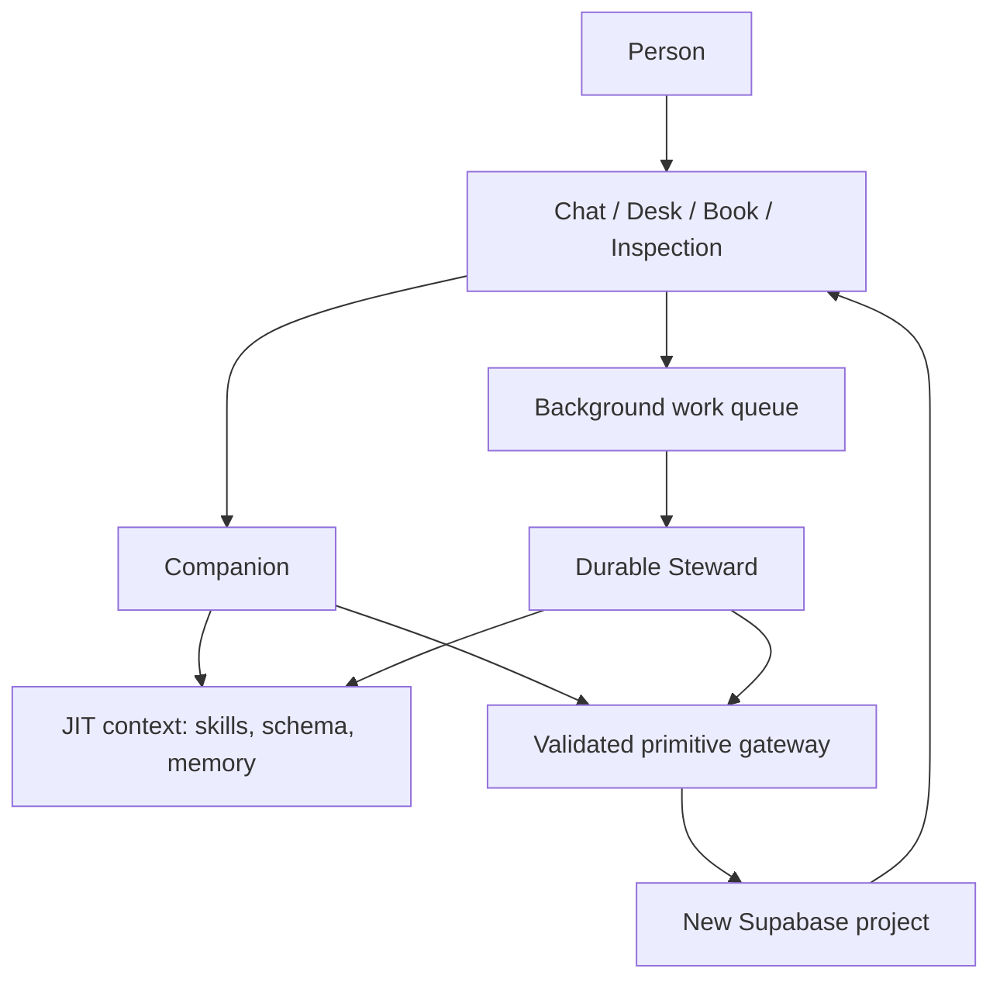

# Architecture — responsibilities and boundaries

**Status:** intended V1 architecture; validate exact library APIs, versions, hosting and operational costs in Cycle 0. No implementation is implied by this document.

## Overall arrangement

## Service responsibilities

| Part | Owns | Must not own |
| --- | --- | --- |
| Companion | User-facing conversation, reflection and foreground action acknowledgement | Bulk background extraction, arbitrary database access, permanent identity judgments |
| Steward | Quiet evidence extraction, organization, linking, pattern proposals, background jobs | Public persona, autonomous consequential external actions |
| JIT context loader | Discover/load needed methods, relevant schema and user evidence | Permissions or source-of-truth writes |
| Primitive gateway | Validated search, reading and bounded record/event/link/transaction mutations; action auditing | Domain-specific assumptions hardcoded for every feature |
| Persistent store | Conversations, structured records, source relationships, versions, jobs, approvals, inspection events | Model-specific instruction behavior |
| Scheduler | Deterministic due dates, recurrence, due views and dispatch | Model inference about whether a session was completed |
| UI | Chat, Daily Desk, Living Book, Inspection Room; status/approval surfaces | Hidden business rules that are impossible to inspect outside the UI |

## Preferred technology direction

- **Mastra** for conversational and durable background agent operation, memory integration and JIT skill discovery; evaluate current stable APIs against the official documentation in Cycle 0.
- **Supabase** for new-project authentication, PostgreSQL data, row-level access, storage, real-time status and queue dispatch.
- **Separate continuously available worker host** for durable Steward runs. Supabase Queues transports jobs; it does *not* execute multi-step model loops by itself. Do not rely solely on time-limited edge functions for arbitrarily long agent runs.
- A mature ready-made **chat interface package** and conventional web application framework (Next.js/assistant-ui are candidates, not irrevocably selected before proof). Avoid custom infrastructure where maintained packages are sufficient.
- AI/model provider is an adapter choice verified during implementation; do not bind domain records to one model's format.

Useful official starting references: [Mastra memory](https://mastra.ai/docs/memory/overview), [durable agents](https://mastra.ai/docs/harness/durable-agents), [on-demand skill search](https://mastra.ai/blog/introducing-skill-search-processor), [observability](https://mastra.ai/docs/observability/overview), [Supabase Queues](https://supabase.com/docs/guides/queues), [Supabase RLS](https://supabase.com/docs/guides/database/postgres/row-level-security).

## Shared invariants

1. The only durable fact about what was said is its preserved original source; model summaries are derived, revisable interpretations.
2. Background action outcomes and application writes are independent of conversational delivery. Success is acknowledged only after validated persistence.
3. A queue job may perform many model/tool turns, checkpoint and resume. Record run identity, heartbeats, attempts and clear terminal states; stalled is not running.
4. Concurrent jobs and foreground edits cannot silently overwrite newer information. Mutations require versions/expected state, identity and idempotency keys.
5. Permission enforcement is server-side and at the database boundary. Neither a skill, generated program nor direct client operation can elevate privileges.
6. All meaningful writes produce source-linked revisions/events usable by the Inspection Room.
7. The new product does not require the former application's runtime, schemas, login configuration or stored job definitions.

## Engineering boundaries and extension points

Use internal contracts for conversation, memory search, record operations, background execution, approval and external integrations. Components depend on these contracts rather than importing each other's implementation details. Do not build a speculative plugin framework before a real second implementation exists; demonstrate replaceability through bounded tests and one deliberate change drill. See [Evolution](EVOLUTION.md).

## Startup and deployment decisions still to verify

- Exact app framework and chat package compatibility.
- Current Mastra durable-agent and memory/storage support with chosen hosting model.
- New Supabase project provisioned only with explicit authorized project/account actions.
- AI provider, usage limits and cost budget.
- Backup/restore plan, retention, indexing and observability data boundaries.

Keep these as **Cycle 0 research outputs**, not silently accepted facts.

